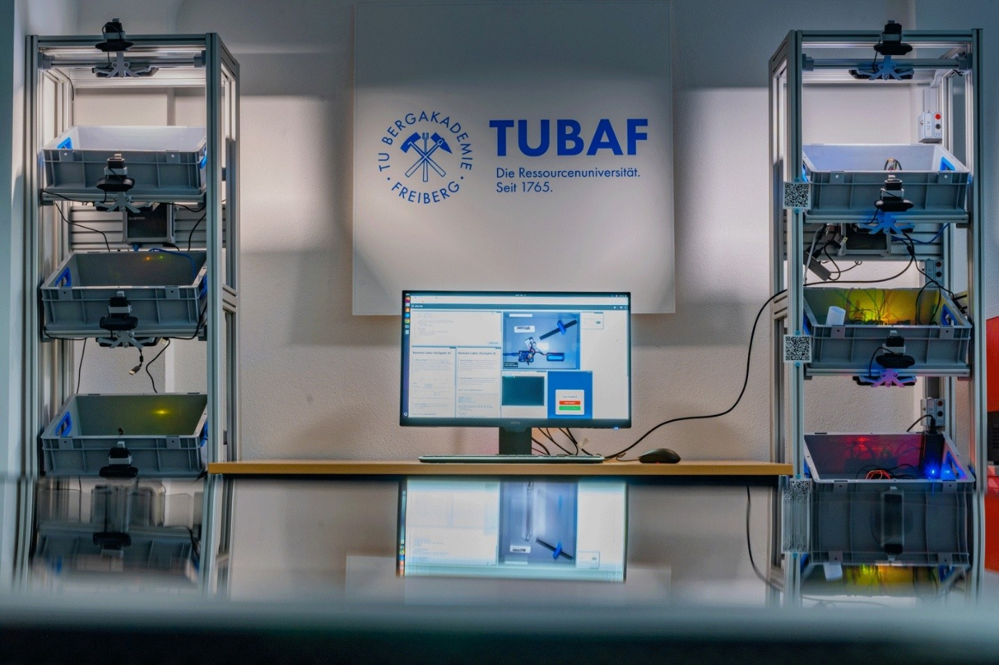
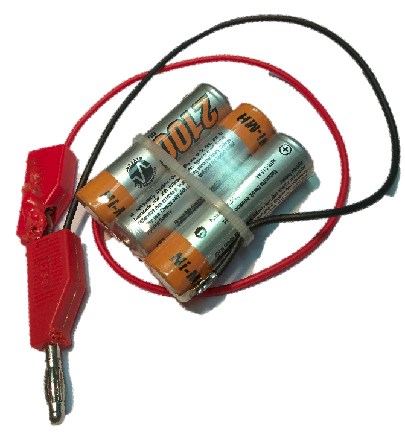
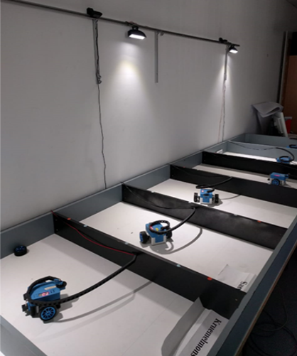
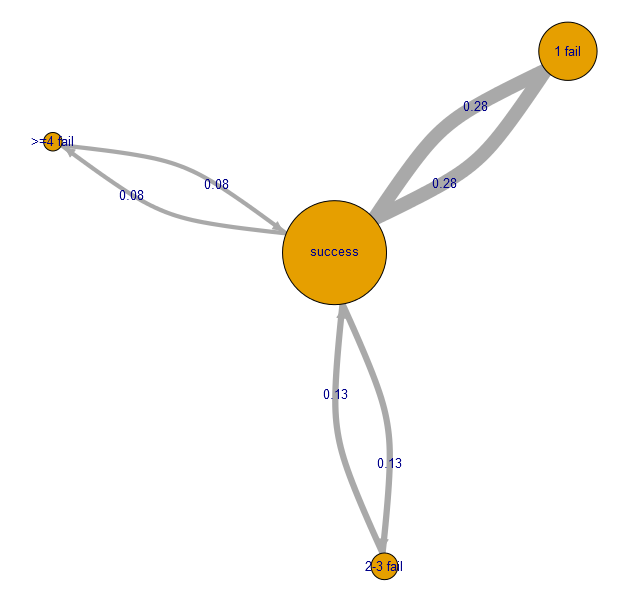
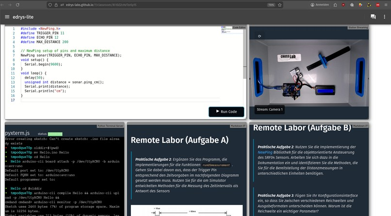
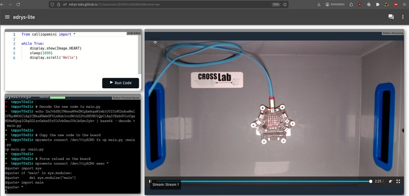

<!--
author:   Sebastian Zug; Martin Bertau; Ines Aubel; Florian Richter; Jihad Hyadi

email:    sebastian.zug@informatik.tu-freiberg.de

version:  1.0.0

language: de

narrator: Deutsch Female

icon:     https://tu-freiberg.de/sites/default/files/styles/large_xl/public/2024-06/Logo1.png?itok=DwUdy4lK

link:     style.css

@style
.flex-container {
    display: flex;
    flex-wrap: wrap;
    align-items: stretch;
    gap: 20px;
}

.flex-child {
    flex: 1;
    margin-right: 20px;
}

@media (max-width: 600px) {
    .flex-child {
        flex: 100%;
        margin-right: 0;
    }
}

.qr {
    text-align: center;
}
@end

@qr: 

-->

[](https://liascript.github.io/course/?https://raw.githubusercontent.com/IfI-MyRemoteMINT/Presentations/main/Netzwerk_Westsachsen_2026/presentation.md#1)

# MyRemoteMINT

Eigene Labore für Schülerinnen und Schüler im ländlichen Raum
------------------------------------------------------------

<section class="flex-container" style="align-items: center;">

<div class="flex-child" style="flex: 1.3; min-width: 300px;">

<!-- style="width: 100%; max-height: 50vh; object-fit: contain;" -->

</div>

<div class="flex-child" style="min-width: 250px;">

__Prof. Dr. Sebastian Zug__ \
Institut für Informatik

__Prof. Dr. Martin Bertau__ \
Institut für Technische Chemie

TU Bergakademie Freiberg

---

6\. Netzwerkveranstaltung \
„Digitale Schule Sachsen“ – Westsachsen \
Schüler-Lab der WHZ Zwickau \
13. November 2026

</div>

</section>

---

> Gefördert in der Initiative Digitale Schule Sachsen, Laufzeit Juli 2026 bis Juni 2028. Dieser Vortrag ist eine Open Educational Resource (OER) unter [CC BY 4.0](https://creativecommons.org/licenses/by/4.0/deed.de): https://github.com/IfI-MyRemoteMINT/Presentations

## Ausgangslage

<section class="flex-container">

<div class="flex-child" style="min-width: 250px;">

> __Echte Experimente sind für guten MINT-Unterricht unverzichtbar.__ Sie machen Theorie anschaulich, fördern Problemlösekompetenz und begeistern für MINT-Berufe.

In der Schule stehen ihnen viele Hürden entgegen:

- Hochwertige Mess- und Robotiksysteme sind für viele Schulen zu teuer.
- Sicherheitsrelevante Experimente dürfen nicht im Klassenzimmer stattfinden.
- Labore sind nur während der Schulzeit nutzbar.
- Die Ausstattung ist ungleich verteilt, besonders im ländlichen Raum.
- Nach einem Workshop an der Hochschule bleibt an der Schule meist nichts zurück.

Das gilt für den Calliope im Informatikunterricht ebenso wie für die Messstation im Biologieunterricht oder das Fotometer in der Chemie.

</div>

<div class="flex-child" style="min-width: 250px;">

<!-- width="80%" -->

</div>

</section>

    {{1}}
> __Unsere Frage:__ Wie bekommen alle Schülerinnen und Schüler Zugang zu echten Experimenten, unabhängig von Ort, Zeit und Ausstattung ihrer Schule?

## Remote-Labore

> __Definition:__ Remote-Labore ermöglichen den Zugriff auf echte Hardware über das Internet. Die Lernenden verändern Parameter, schreiben Programme und beobachten das Ergebnis über Kamera und Messdaten.

Im Unterschied zur Simulation zeigt ein Remote-Labor die Wirklichkeit, mit Messfehlern, Umgebungseinflüssen und allem, was dazugehört.

<section class="flex-container">

<div class="flex-child" style="min-width: 250px;">

__Unsere Erfahrung seit 2017__

")



</div>

<div class="flex-child" style="min-width: 250px;">

__Was wir daraus gelernt haben__

- Remote-Labore funktionieren und werden intensiv genutzt.
- Aufgaben ändern konnten aber nur Fachleute.
- Server und Wartung waren aufwendig.

→ Im Projekt __CrossLab__ (2021–2025) entstand daraus __Edrys lite__: Labore aus Bausteinen, ohne Server.

</div>

</section>

## Die Idee von MyRemoteMINT

> MyRemoteMINT bringt die Remote-Labore aus der Hochschullehre in die Schulen und ergänzt sie um __mobile Hardware-Baukästen__, die __LabSets__.

<!-- data-type="none" -->
| Ebene                                      | Wer betreibt das Labor?                     | Wofür?                                                                       |
| ------------------------------------------ | ------------------------------------------- | ---------------------------------------------------------------------------- |
| __1. Individuelle Remote-Labore__          | Schülerinnen und Schüler, zu Hause          | eigene Fragestellungen, angeregt durch Interesse oder Unterricht             |
| __2. Partizipative Remote-Labore__         | Lernende gemeinsam mit ihren Lehrkräften, an der Schule | Unterricht, AGs und Projektarbeiten, geöffnet auch für andere Schulen |
| __3. Zentrale Remote-Labore__              | TU Bergakademie Freiberg und BSZ „Julius Weisbach“ Freiberg | spezialisierte Experimente, die über den Lehrplan oder die Ausstattung einer Schule hinausgehen |

    {{1}}
<section>

So entsteht ein __verteiltes Labor-Netzwerk__: Schulen betreiben eigene Labore, nutzen die Angebote anderer und lernen voneinander. Alle Materialien sind __OER__ und schulübergreifend nutzbar.

</section>

    {{2}}
<section>

__Nicht nur Informatik__

<!-- data-type="none" -->
| Fach       | Beispiele für Remote-Labore und LabSets                                      | Stand                    |
| ---------- | ---------------------------------------------------------------------------- | ------------------------ |
| Informatik | Calliope mini, Arduino, fahrende Roboter                                     | Hochschullabore vorhanden |
| Physik     | Sensorkennlinien, Distanzmessung, Analog-Digital-Wandlung                     | geplant                   |
| Biologie   | Umweltsensorik (Licht, Temperatur, pH), Gewächshaus mit Portalroboter am BSZ | Gewächshaus am BSZ vorhanden, Rest geplant |
| Chemie     | elektrochemische Messungen, Chromatographie, Spektroskopie                   | erste Labore der Technischen Chemie vorhanden |

</section>

### LabSets – von Remote zu Real

<section class="flex-container">

<div class="flex-child" style="min-width: 250px;">

__Der Weg zum eigenen Labor__

1. Workshop im RoboLab Freiberg: Setups kennenlernen und ausprobieren
2. eigenen Baukasten aufbauen und als Remote-Labor einrichten
3. Baukasten bleibt an der Schule oder geht mit nach Hause
4. Labor lokal nutzen oder für andere öffnen

</div>

<div class="flex-child" style="min-width: 250px;">

__Zu jedem LabSet gehören__

- Dokumentation und Bauanleitung
- Laborbeschreibung für Edrys lite
- Beispielcode und Versuchsanleitungen
- Aufgabenblätter und Video-Tutorials

alles unter __CC BY 4.0__ und auf Git-Plattformen veröffentlicht.

</div>

</section>

### Passt das in den Lehrplan?

> Wir haben die sächsischen Lehrpläne für Informatik, Physik, Chemie, Biologie, Biotechnik und Technik/Computer an Oberschule, Gymnasium und Beruflichem Gymnasium nach Anknüpfungspunkten durchsucht.

<section class="flex-container">

<div class="flex-child" style="min-width: 250px;">

<!-- data-type="none" -->
| Fach              | Anknüpfungspunkte |
| ----------------- | ----------------: |
| Physik            |                44 |
| Informatik        |                38 |
| Chemie            |                26 |
| Biologie          |                21 |
| Biotechnik        |                 4 |
| Technik/Computer  |                 4 |
| __Summe__         |           __137__ |

</div>

<div class="flex-child" style="min-width: 250px;">

__Beispiele__

- Informatik GY Kl. 7, Informatiksysteme: Calliope als EVA-System
- Biologie OS Kl. 9, Grundlagen der Ökologie: abiotische Faktoren digital messen
- Physik GY: verbindliche Schülerexperimente mit digitaler Messwerterfassung

</div>

</section>

    {{1}}
<section>

__Nicht jedes Labor heißt programmieren.__ Dieselbe Hardware trägt vier Stufen:

<!-- data-type="none" -->
| Stufe                          | Was die Lernenden tun                                        | Typische Klassen |
| ------------------------------ | ------------------------------------------------------------ | ---------------- |
| 1. Beobachten                  | Experiment starten, Live-Bild und Messwerte verfolgen        | 5–8              |
| 2. Messen und Auswerten        | Parameter variieren, Messreihen aufnehmen, Diagramme deuten  | 7–10             |
| 3. Programmieren und Modellieren | eigenen Code schreiben, Messung und Modell vergleichen     | 9–12             |
| 4. Gestalten                   | ein eigenes Experiment oder LabSet planen, bauen, freigeben  | 10–13            |

</section>

<!-- class="reference" -->
> __Quelle:__ eigene Auswertung der Lehrplandatenbank des Schulportals Sachsen, Stand Oktober 2026. Die Zuordnung ist eine Einschätzung des Projektteams und wird mit den Partnerschulen abgestimmt.

## Die Technik: Edrys lite

> __Idee:__ Ein Labor ist eine __Textdatei__, die fertige __Module__ kombiniert. Lernende brauchen nur einen Browser und einen Link.



    {{1}}
<section>

<!-- data-type="none" -->
| [Module](https://github.com/edrys-labs) (Beispiele) | Zweck                                          |
| --------------------------------------------------- | ---------------------------------------------- |
| Markdown, LiaScript                                 | Anleitungen, Aufgaben, Quiz                    |
| Code-Editor                                         | Programmieren, gemeinsam für alle sichtbar     |
| MicroPython-/Arduino-Simulator                      | Vorbereiten und testen ohne Hardware           |
| Kamerastream                                        | Das echte Gerät beobachten                     |
| Terminal, serieller Monitor                         | Code auf das Gerät laden und ausführen         |
| Whiteboard, Chat, Umfrage                           | Zusammenarbeit und Rückmeldung                 |

</section>

    {{2}}
<section>

Was daraus folgt:

- __Ein Labor anpassen__ heißt Text bearbeiten, nicht programmieren. Das können auch Lehrkräfte und Lernende.
- __Die Hardware wechseln__ heißt wenige Zeilen ändern: Arduino, ESP32, Calliope mini oder ein Linux-Terminal.
- __Ein Labor weitergeben__ heißt eine Datei teilen, als OER.

</section>

### Ohne Server und ohne Anmeldung

> Klassische Remote-Labore brauchen eine zentrale Serverinfrastruktur. Edrys lite verbindet die Browser direkt miteinander.

``` ascii
Klassisch mit zentralem Server               Direkt von Browser zu Browser

      👨🏾‍💻 --.     .-- 👩‍💻                          - - - --👨🏾‍💻-----👩‍💻
            \   /                                              /  \
                                                              /    \
  👩‍💻 ------  🖥️  ------ 👨🏾‍💻                           👩‍💻------+-----👨🏾‍💻- - -
                                                       \    /      /
            /   \                                       \  /      /
      👨🏾‍💻 --'     '-- 👩‍💻                                  👨🏾‍💻     👩‍💻- - - -
```

    {{1}}
<section>

<!-- data-type="none" -->
| Eine Station braucht ...                              | ... und keinen                          |
| ----------------------------------------------------- | --------------------------------------- |
| einen Rechner mit Chrome oder Edge                    | eigenen Server oder Cloud-Vertrag       |
| das Gerät per USB und eine Webcam                     | Portfreigaben in der Firewall           |
| bei Bedarf Docker für die Programmierwerkzeuge        | Installation auf den Schülergeräten     |

> Damit können Schulen ihre Labore selbst betreiben. In sehr restriktiven Schulnetzen prüfen wir die Verbindung gemeinsam vor Ort.

</section>

## Live-Demo: ein Remote-Labor in fünf Minuten

    --{{0}}--
Ich mache jetzt meinen Laptop zu einer Station. Hier am USB-Anschluss steckt ein Arduino Nano ESP32, darüber hängt eine Webcam. Genau so könnte ein LabSet an einer Schule aussehen.

1. Die Laborbeschreibung `esp32_lab_de.yaml` wird in Edrys lite geladen.
2. Ein zweites Browserfenster wird zur __Station__: Arduino Nano ESP32 per USB, Webcam auf das Board, ein Docker-Container mit `arduino-cli`.
3. Im Klassenraum wird der C++-Code geändert und auf Run gedrückt. Der Code wird kompiliert und auf das echte Board geladen.
4. Wir sehen die RGB-LED im Kamerabild und die Ausgaben im seriellen Monitor.

    {{1}}
<section>

Für Technikinteressierte: die komplette Stationssoftware, gestartet mit einem Befehl.

``` bash
docker run -d --name edrys-station \
  -p 127.0.0.1:5000:5000 \
  --device /dev/ttyACM0 \
  -v /dev/bus/usb:/dev/bus/usb \
  --device-cgroup-rule 'c 166:* rmw' \
  --device-cgroup-rule 'c 189:* rmw' \
  edryslabs/module-pyxtermjs:latest
```

</section>

    --{{0}}--
Dieser eine Befehl ist die ganze Stationssoftware. Der Container bringt die Arduino-Werkzeuge und einen kleinen Terminal-Server mit. Der serielle Anschluss und der USB-Bus werden durchgereicht, damit der Container das Programm auf das Board laden kann.

## Laufende Labore in Freiberg

Diese Stationen aus unserer Hochschullehre laufen dauerhaft im RoboLab. Sie sind der Ausgangspunkt für die zentralen Remote-Labore und ihre Schulvarianten.

<section class="flex-container">

<div class="flex-child" style="min-width: 250px;">

__Calliope-mini-Labor__ (MicroPython und Sensoren, mit Simulator)

@qr(https%3A%2F%2Fedrys-labs.github.io%2F%3F%2Fclassroom%2Fj83SVIVcOd5ARUtd)

https://edrys-labs.github.io/?/classroom/j83SVIVcOd5ARUtd

</div>

<div class="flex-child" style="min-width: 250px;">

__Interrupts und Timer__ (LED-Ring)

@qr(https%3A%2F%2Fedrys-labs.github.io%2F%3F%2Fclassroom%2FsEHRNUR9TnhA8wYs)

https://edrys-labs.github.io/?/classroom/sEHRNUR9TnhA8wYs

</div>

</section>



> __Und mit einer ganzen Klasse?__ Eine Station kann immer nur eine Person gleichzeitig programmieren. Deshalb arbeiten die Lernenden zuerst im Simulator und gehen dann an die Station. Mehrere gleiche Stationen laufen parallel, alle anderen schauen im Kamerabild zu. Für die zentralen Labore entsteht ein Buchungssystem.

## Was bedeutet das für eine Schule?

<!-- data-type="none" -->
| Frage                      | Antwort                                                                                         |
| -------------------------- | ----------------------------------------------------------------------------------------------- |
| __Technik__                | Browser auf vorhandenen Geräten; für eine eigene Station ein Rechner, das Gerät und eine Webcam |
| __Hardware__               | LabSets werden im Projekt entwickelt und beschafft und bleiben an der Schule                    |
| __Zeit__                   | Workshops von ein bis zwei Tagen im RoboLab oder vor Ort; danach Begleitung durch das Projektteam |
| __Datenschutz__            | keine Benutzerkonten, keine zentrale Datenhaltung, die Kamera zeigt nur das Gerät; die Evaluation ist datenschutzsensibel angelegt |
| __Anerkennung__            | Arbeit mit LabSets als BELL, Komplexe Lernleistung oder Projektarbeit; ein Konzept dafür entsteht im Projekt |
| __Nach 2028__              | OER bleiben frei verfügbar, LabSets bleiben an den Schulen, Workshops sollen in die Fortbildungen des LaSuB übergehen, das Institut für Informatik bietet weiter Fortbildungen an |

## Wie wir vorgehen

> MyRemoteMINT entwickelt nicht am Schreibtisch, sondern gemeinsam mit den Partnerschulen und in mehreren Runden.

<!-- data-type="none" -->
| Schritt                          | Was wir tun                                                                                                   |
| -------------------------------- | ------------------------------------------------------------------------------------------------------------- |
| __1. Lehrpläne auswerten__       | Anknüpfungspunkte in den sächsischen Lehrplänen für sechs Fächer und drei Schularten (abgeschlossen)          |
| __2. Bedarfe erheben__           | an den Partnerschulen: kurzer Online-Fragebogen zu Schule, Unterricht und Ausstattung, danach ein Interview mit Lehrkräften |
| __3. Demo-Setups zeigen__        | im Interview und in Workshops ein Remote-Labor live vorführen, mit Fachkarten zu Beispielexperimenten je Fach |
| __4. Erproben und verbessern__   | Schulvarianten der Labore und LabSet-Prototypen mit Lernenden und Lehrkräften testen: Was ist verständlich, wo hakt die Technik? |
| __5. Wirkung prüfen__            | Befragungen vor und nach der Arbeit mit den Laboren, Interviews, datenschutzsensibel erfasste Nutzungsdaten   |
| __6. Teilen__                    | Labore und Materialien als OER in einem durchsuchbaren Repository, angebunden an OPAL Schule, LernSax und MeSax |

    {{1}}
<section>

__Zeitplan:__ Planung (Monate 1–3) → Umsetzung (4–12) → Testen und Iteration (13–20) → Abschluss und Verstetigung (21–24)

__Woran wir uns messen:__ mindestens 10 aktive Schulpartnerschaften, 15 veröffentlichte OER, 25 Lehrkräfte im Netzwerk, und mindestens die Hälfte der Lernenden berichtet von gestiegener Motivation.

</section>

## Mitmachen

__Was wir uns wünschen__

- Lehrkräfte aller MINT-Fächer, die Remote-Labore im Unterricht, in AGs oder an Projekttagen erproben
- Ideen für Experimente aus Ihrem Unterricht
- Schulen, die ein eigenes LabSet aufbauen und für andere öffnen

> __Der erste Schritt:__ Sprechen Sie uns an. Wir klären mit einem kurzen Fragebogen und einem Gespräch Ihre Fächer, Themen und Klassenstufen und laden Sie zu einem Workshop ein.

    {{1}}
<section>

Welches Experiment aus Ihrem Fach würden Sie gern aus der Ferne nutzen oder mit anderen Schulen teilen?

[[___ ___ ___]]

</section>

## Kontakt und Links

<!-- data-type="none" -->
| Angebot                         | Link                                  |
| ------------------------------- | ------------------------------------- |
| Edrys lite und alle Labore      | https://edrys-labs.github.io          |
| Quellcode der Module und Labore | https://github.com/edrys-labs         |
| LiaScript für Begleitmaterial   | https://liascript.github.io           |
| Dieser Vortrag                  | https://github.com/IfI-MyRemoteMINT/Presentations |

__Labore selbst starten__ (es entsteht jeweils ein neuer, eigener Klassenraum):

- [Arduino-Nano-ESP32-Labor](https://edrys-labs.github.io/?/deploy/https://raw.githubusercontent.com/IfI-MyRemoteMINT/Presentations/main/Netzwerk_Westsachsen_2026/esp32_lab_de.yaml) (aus der Live-Demo)
- [Calliope-mini-Labor](https://edrys-labs.github.io/?/deploy/https://raw.githubusercontent.com/edrys-labs/lab-calliope-mini/main/lab_calliope_mini.yaml) (MicroPython, mit Simulator)

__Ansprechpartner an der TU Bergakademie Freiberg__

<!-- data-type="none" -->
| Name                     | Institut                                                   | E-Mail                                   |
| ------------------------ | ---------------------------------------------------------- | ---------------------------------------- |
| Prof. Dr. Sebastian Zug  | Institut für Informatik, Softwaretechnologie und Robotik   | sebastian.zug@informatik.tu-freiberg.de  |
| Prof. Dr. Martin Bertau  | Institut für Technische Chemie                             | martin.bertau@chemie.tu-freiberg.de      |

__Projektteam:__ Dr. Ines Aubel (Institut für Technische Chemie), Florian Richter, Jihad Hyadi
